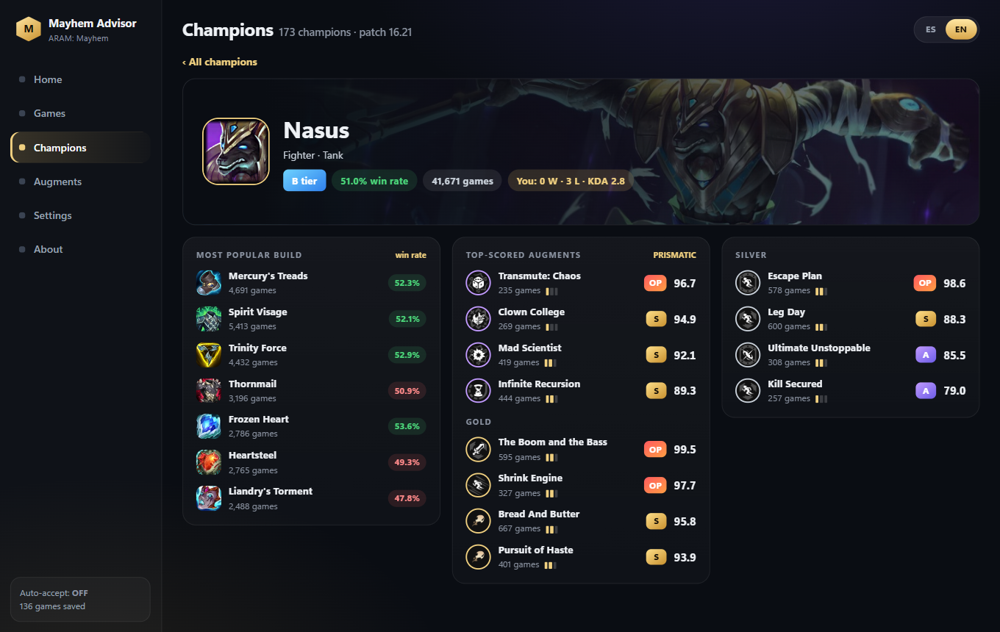
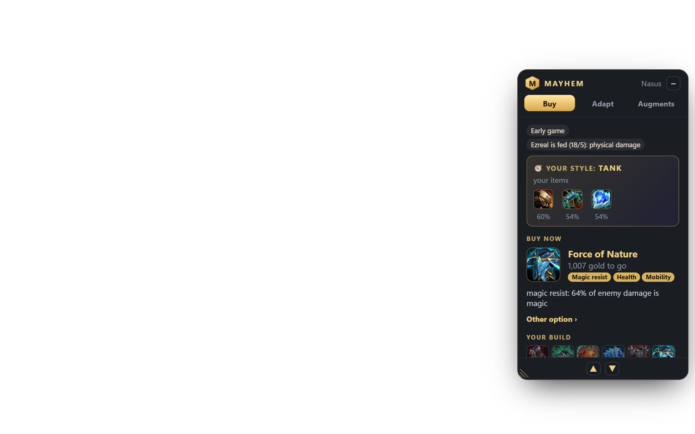
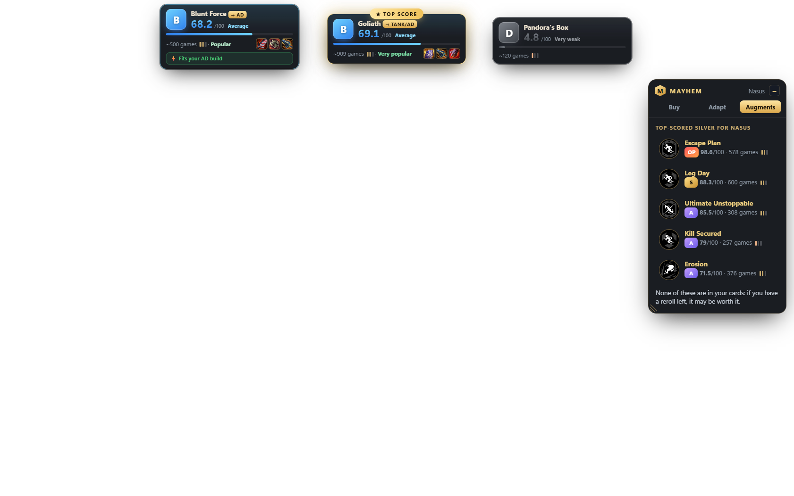
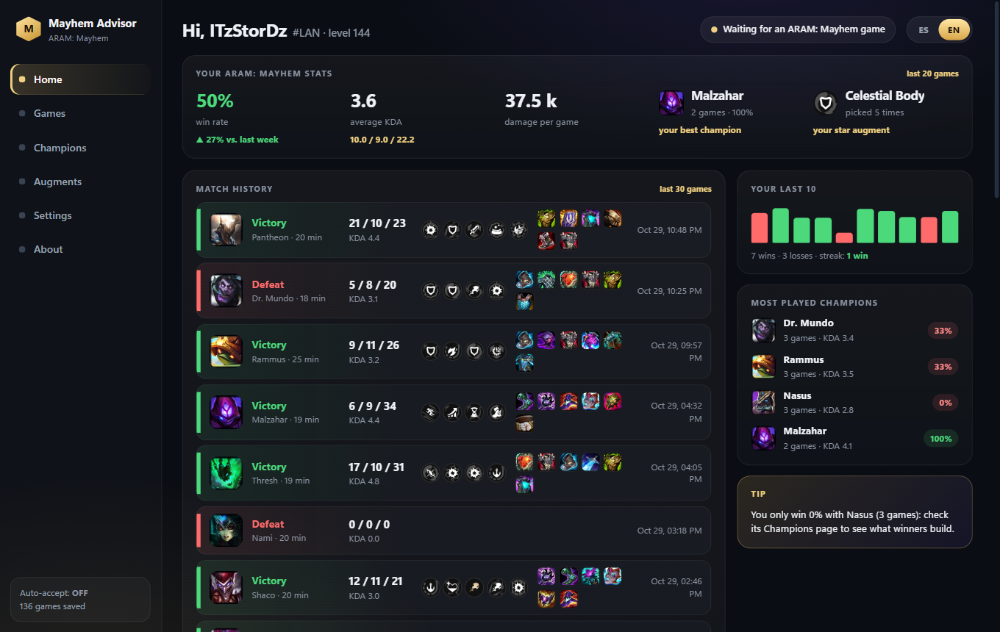

# Mayhem Advisor

**An overlay and companion app for League of Legends' ARAM: Mayhem — augment scores, a build that adapts to your
augments and the enemy team, and a report after every game.**

Created by **[ItzStorDz](https://github.com/ItzStorDz)**. English and Spanish.

## What it does

- **Augment cards:** when the augment choice appears, each card gets a 0–100 score, a grade (OP / S / A / B …) and
  the build style it pushes you toward (AP, tank, crit…).
- **In-game panel** (can be moved, minimized, and resized from its bottom-left corner):
  - **Buy:** what to buy next and why (for example, "64% of enemy damage is magic").
  - **Adapt:** the build changes with your augments and with what the enemy team builds.
  - **Augments:** the best-scored augments for your champion.
  - Warns you when an enemy is fed and what kind of damage they deal.
- **Shop build:** your recommended build is sent to the in-game shop as an item set.
- **Champion select:** best augments and build for your champion; optional auto-accept.
- **After the game:** score, ranking among the 10 players, what to improve next time, and the build you bought
  compared with the app's build.
- **Your history:** win rate, KDA, most-played champions, and every ARAM: Mayhem game, saved a few seconds after it ends.

| In-game panel | Augment cards |
|---|---|
|  |  |

## Is it safe?

The code is public so you can check it yourself. Mayhem Advisor:

- **does not inject anything into the game or read its memory**;
- reads only what Riot exposes on your own PC: the League client's local API and the in-game
  [Live Client Data API](https://developer.riotgames.com/docs/lol#game-client-api);
- reads the augment cards from the screen with Windows' built-in text recognition (OCR), like a screenshot;
- does not show augment win rates (Riot's policy for third-party apps); it shows its own scores instead;
- connects only to CommunityDragon (game data) and GitHub (to check for updates).

## Install

Download the latest installer from **[Releases](https://github.com/ItzStorDz/mayhem-advisor/releases)** and run it.
Windows 10/11, 64-bit. Windows SmartScreen may warn you because the installer is not signed yet: choose
*More info → Run anyway*.

After that, the app tells you when a new version is out and installs it with one click (never while the game is
open; your games and settings are kept). The download is checked against GitHub's SHA-256 fingerprint before it runs.

## Data sources

- Game data, icons, and prices: [CommunityDragon](https://communitydragon.org/).
- ARAM: Mayhem statistics: [mayhemmeta.com](https://mayhemmeta.com/), [ARAMKit](https://aramkit.com/), and
  [AramHex](https://github.com/czgreat/aramhex-data) (CC BY-NC 4.0).
- Your own games, read from your League client.

See [CREDITOS.md](CREDITOS.md) for details.

## Project layout

| Folder | What it is |
|---|---|
| `src/Core` | Recommendations, scores, game data, match history (C#/.NET 9) |
| `src/Overlay` | Windows app and main window (WPF + WebView2) |
| `overlay-electron` | In-game panel and augment cards (Electron) |
| `herramientas` | Scripts that refresh the statistics once per patch |
| `instalador` | Inno Setup installer script |
| `pruebas` | Test tools (a simulated game, an English-text check) |

## License

**All rights reserved.** You may read this code and use the official releases for personal use, but you may not
copy, modify, or redistribute it without written permission. See [LICENSE](LICENSE).

Mayhem Advisor isn't endorsed by Riot Games and doesn't reflect the views or opinions of Riot Games or anyone
officially involved in producing or managing Riot Games properties. Riot Games, and all associated properties are
trademarks or registered trademarks of Riot Games, Inc.
